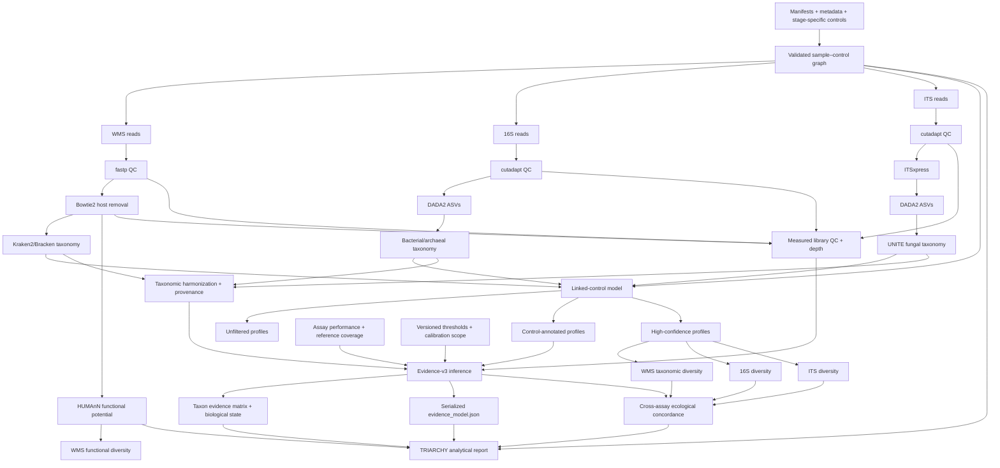

# TRIARCHY workflow

TRIARCHY preserves assay-native measurements while integrating taxonomic,
control, and ecological evidence.

The canonical standalone Mermaid source is
[`docs/overall-workflow-dag.mmd`](docs/overall-workflow-dag.mmd). Generate the
publication-ready vector PDF with:

```bash
.tools/env/bin/python scripts/render_workflow_dag_pdf.py
```

The default output is `output/pdf/triarchy-overall-workflow-dag.pdf`. Override
it with `--output PATH`. The renderer uses `reportlab`, which is declared in
`environment.yml` and installed by `install.sh`.



The integration layer compares evidence only where assay scope overlaps:

- WMS and 16S for bacteria and archaea;
- WMS and ITS for fungi;
- WMS alone for functional potential.

Joint diversity is not calculated unless a separately validated multi-table or
latent-community model supplies a justified common representation.
